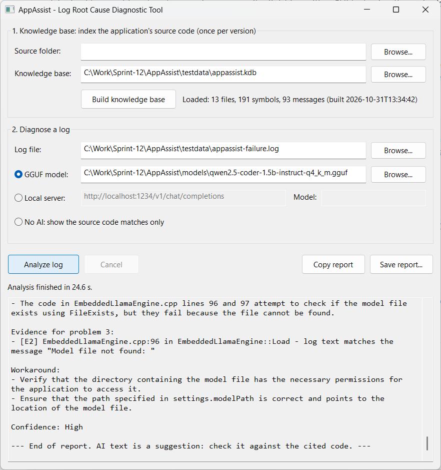
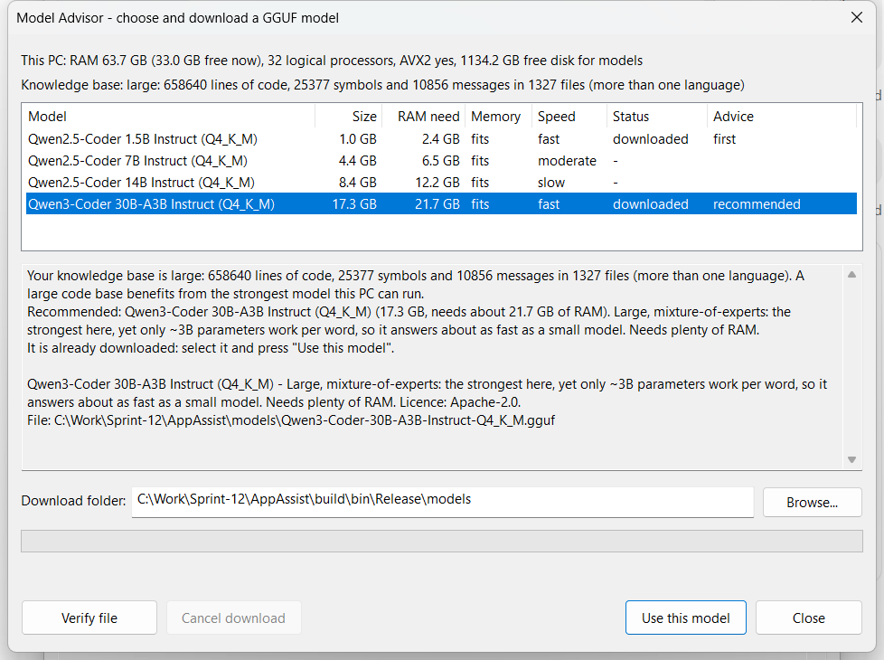

# AppAssist — Log Root Cause Diagnostic Tool

A Windows desktop tool (MFC, Visual Studio 2022) that reads an application's **log**, finds the
errors, matches them to the application's **own source code**, and asks a **local AI model** to
explain the root cause and suggest workarounds — fully offline. The model runs inside the
program through an embedded, statically linked [llama.cpp](https://github.com/ggml-org/llama.cpp);
no server, service or internet connection is needed. A local HTTP server (LM Studio, Ollama) can
be used instead.



## How it works

1. **Knowledge base** (once per version of your code): AppAssist walks a source folder
   (Python `.py`, Java `.java`, C# `.cs`, Scala `.scala`/`.sc`, C/C++ `.cpp`, `.hpp`, `.h`, `.cxx`,
   `.cc`) and records:
   - classes, structs and function signatures, and the text of every log / error / exception
     message in the code, each with its file and line;
   - **program flow**: the functions each function calls, and for each message the conditions
     that lead to it (`if (!FileExists(path))`, `else`, `catch (IOException e)`, `case`, Python
     `if`/`except`);
   - **settings** the code reads, and tunable constants:

     | Language | Settings | Constants |
     | --- | --- | --- |
     | All | environment variables, command-line options | |
     | C++ | registry / MFC profile, INI | `static const`, `constexpr`, `#define` |
     | Python | `configparser`, `argparse`, wx and Qt settings | module-level `UPPER_CASE` |
     | Java | system properties, `Properties`, Spring `@Value` | `static final` |
     | C# | `IConfiguration` (`appsettings.json`), `ConfigurationManager.AppSettings`, registry, `Settings.Default` | `const`, `static readonly` |
     | Scala | `sys.env`, `sys.props`, Typesafe Config (`config.getString("a.b")`), scopt | `final val Name` |
   - **config files** in the tree (`.ini`, `.cfg`, `.conf`, `.env`, `.properties`, `.json`,
     `.yaml`, `.toml`, and HOCON `application.conf`, up to 256 KB) with their keys and current
     values.

   The result is saved as a `.kdb` file (JSON). Dependencies, build output, virtual environments
   and bundled Python installations are skipped. A knowledge base from an earlier version still
   loads; the report asks you to rebuild it to get flow and settings.
2. **Matching without AI** — the part you can trust: errors in the log are found, multi-line
   messages and stack traces are kept together (including Java's uncaught
   `Exception in thread "main"` and .NET's `Unhandled exception.`), repeats are grouped (`x3`),
   and each problem is matched to the source by:
   - **stack frames** (`File "x.py", line 33`, `at a.B.c(B.java:40)`, `at A.B() in C:\src\B.cs:line 42`,
     `(B.scala:15)` or `file.cpp(123)`): the exact failing line;
   - **message text**: the log line matches a message string in the code (placeholders like
     `%s`, `{}` and f-string fields are allowed to differ), which finds where the error was
     raised or logged even when there is no stack trace;
   - **code names**: CamelCase/snake_case identifiers in the error that name a class or function.

   Each match ("evidence") is shown with the surrounding source lines, **happens when** (the
   conditions that lead there) and **reached from** (a call path, e.g.
   `InventoryApp.main -> InventoryApp.run -> ConfigLoader.load -> ConfigLoader.parsePageSize`).
   Then **Settings that may resolve it** lists, per problem, the settings `[C<n>]` linked to it,
   strongest first, each with *why* and *how to change it*. A setting is linked when:
   - its value is used on the failing line or on a call on the way there;
   - it decides a condition that leads to the error (`if (attempt > MAX_RETRIES)`);
   - it is read in the failing function or next to it in the call graph;
   - the log names it, or shows its value. For example, `For input string: "fifty"` is matched
     to `page.size = fifty` in `config/inventory.properties`.

   Settings stored in the same variable are shown as alternatives to each other, for example
   `-Dinventory.pageSize` next to `page.size`.
3. **AI explanation**: the problems, evidence and settings go to the model, which must cite
   `[E<n>]` and `file:line` for every claim, give a root cause, a workaround (naming a setting
   `[C<n>]` when one would help) and a confidence, mark workarounds as *"Inferred from the code —
   unverified"*, and say so when the evidence is not enough. With **No AI** selected you still
   get steps 1–2.

## Using it

1. **Source folder** → **Browse…** → **Build knowledge base** (or pick an existing `.kdb`).
2. **Log file** → **Browse…**.
3. Choose the AI engine:
   - **GGUF model** — any instruct model in GGUF format, run in-process on the CPU.
     **Models…** opens the **Model Advisor** (below), which picks and downloads one for you.
   - **Local server** — an OpenAI-compatible endpoint, e.g. LM Studio
     `http://localhost:1234/v1/chat/completions` or Ollama
     `http://localhost:11434/v1/chat/completions`, plus the model name.
   - **No AI** — source matches only.
4. **Analyze log**. The report streams into the window; **Copy report** / **Save report…**.

The first analysis loads the model (seconds to a minute); later ones reuse it.

### Model Advisor



**Models…** (next to the GGUF path) shows what this PC can run and what is already downloaded,
and advises in two steps:

1. **First model.** Without a knowledge base it suggests the *smallest* catalog model that runs
   comfortably here (needs at most 75 % of the RAM), so you can start quickly. At startup, if no
   model is selected, the report window says which one that is.
2. **Next model.** Once a knowledge base exists, its size decides how much model is worth having:

   | Knowledge base | Rule | Preferred models (best first) |
   | --- | --- | --- |
   | small | under 15 000 lines and 1 500 symbols | Qwen 1.5B; alternatives Qwen 3B, Gemma 3 4B |
   | medium | under 150 000 lines and 15 000 symbols | Qwen 7B, DeepSeek-Coder-V2-Lite, Llama 3.1 8B, Gemma 3 12B, then the small ones |
   | large | anything bigger | Qwen3 30B-A3B, Qwen 32B, Qwen 14B, Phi-4, DeepSeek-Coder-V2-Lite, then the smaller ones |

   The first preference that fits the RAM comfortably (else tightly) and the free disk wins. If
   it is bigger than the selected model, the advisor suggests the upgrade; building a knowledge
   base also prints this advice at the end of its summary.

The thresholds, preferences and the catalog are data in [`config/models.json`](config/models.json):
built into the programs, and copied next to them as `models.json`, which can be edited without
rebuilding. The same file holds a second task profile, **code conversion**, which sizes models by
the largest file to convert. [docs/model-advisor-pattern.md](docs/model-advisor-pattern.md)
explains the pattern and how to add models and tasks, or reuse it in another application.

The catalog (all Q4_K_M GGUF files; the Qwen ones are by Qwen except the 30B by Unsloth and the
32B by bartowski, the Gemma ones by Unsloth, the others by bartowski):

| Model | File size | RAM needed | Licence | Notes |
| --- | --- | --- | --- | --- |
| Qwen2.5-Coder 1.5B Instruct | 1.0 GB | 2.4 GB | Apache-2.0 | Starter: fast, shallower explanations |
| Qwen2.5-Coder 3B Instruct | 2.0 GB | 3.5 GB | Qwen Research (**non-commercial**) | Between the 1.5B and 7B; good on 8 GB PCs |
| Phi-4-mini 3.8B Instruct | 2.3 GB | 4.7 GB | MIT | In the catalog but not offered for log diagnosis: in testing it ignored the report format and cited evidence that does not exist |
| Gemma 3 4B Instruct | 2.3 GB | 4.7 GB | Gemma Terms of Use | Small general model; clear explanations |
| Qwen2.5-Coder 7B Instruct | 4.4 GB | 6.5 GB | Apache-2.0 | Standard: clearly better reasoning about code |
| Llama 3.1 8B Instruct | 4.6 GB | 7.3 GB | Llama 3.1 Community | Widely used general model |
| Gemma 3 12B Instruct | 6.8 GB | 11.8 GB | Gemma Terms of Use | Strong general reasoning; dense, slower |
| DeepSeek-Coder-V2-Lite 16B Instruct | 9.7 GB | 14.2 GB | DeepSeek License | Mixture-of-experts: ~2.4B parameters per token, so fast on a CPU |
| Qwen2.5-Coder 14B Instruct | 8.4 GB | 12.2 GB | Apache-2.0 | Large, dense: thorough but slow on a CPU |
| Phi-4 14B | 8.4 GB | 12.3 GB | MIT | Large, dense reasoning model; slow on a CPU |
| Qwen3-Coder 30B-A3B Instruct | 17.3 GB | 21.7 GB | Apache-2.0 | Large, mixture-of-experts: strongest, yet only ~3B parameters work per token, so it is about as fast as a small model |
| Qwen2.5-Coder 32B Instruct | 18.5 GB | 24.3 GB | Apache-2.0 | Strongest dense coder; very slow on a CPU, needs 32 GB+ |

Check that a model's licence allows your use before downloading it.

"RAM needed" is the file plus 15 %, the context cache (8K tokens for log diagnosis) and 1 GB of
headroom.

**Download** fetches the highlighted model with WinHTTP into the download folder (default: the
selected model's folder, else `models\` next to the program if writable, else
`%LOCALAPPDATA%\AppAssist\models`):

- it **resumes**: a cancelled or interrupted download continues from where it stopped
  (`<file>.part`), including a partial file left by another tool under the final name;
- a stalled connection (no data for 60 s) or dropped connection is retried automatically;
- free disk space is checked first;
- the finished file is **verified against the published SHA-256** before it is renamed into place;
  a damaged file is renamed to `.corrupt`. For a model that is already downloaded the button
  reads **Verify file** and only checks it.

**Use this model** (or double-click) puts the model's path in the main window.
`scripts\fetch_model.ps1` still works for downloading from a script.

### Command line

`AppAssistCli.exe` runs the same engine, for scripts and CI:

```powershell
AppAssistCli index   C:\src\MyApp   MyApp.kdb
AppAssistCli analyze MyApp.kdb  app.log  --model models\qwen2.5-coder-1.5b-instruct-q4_k_m.gguf  --out report.txt
AppAssistCli analyze MyApp.kdb  app.log  --http http://localhost:1234/v1/chat/completions --http-model qwen2.5-coder-7b
AppAssistCli analyze MyApp.kdb  app.log          # no AI: source matches only

AppAssistCli models                              # this PC, the catalog, the first model to get
AppAssistCli models   --kb MyApp.kdb --model models\qwen2.5-coder-1.5b-instruct-q4_k_m.gguf
AppAssistCli download first                      # the smallest model that runs well here
AppAssistCli download recommended --kb MyApp.kdb # the one that suits this knowledge base
AppAssistCli download qwen2.5-coder-7b --dir D:\models
AppAssistCli models   --task code-conversion --source C:\src\Legacy   # another task profile
AppAssistCli --version                           # e.g. AppAssistCli 1.4.2.317
```

Options: `--ctx <tokens>` (default 8192), `--max-tokens <n>` (900), `--threads <n>`.
`download` resumes a partial file, verifies the SHA-256, prints the model's path on success, and
stops cleanly on Ctrl+C (the partial file is kept).
Exit codes: 0 success, 1 usage, 2 failure, 3 cancelled (Ctrl+C).

## Building

Requirements: Windows 10/11 x64, **Visual Studio 2022** with *Desktop development with C++* and
*C++ MFC for latest build tools* (CMake comes with Visual Studio).

```powershell
powershell -ExecutionPolicy Bypass -File scripts\build.ps1           # Release
powershell -ExecutionPolicy Bypass -File scripts\build.ps1 -Config Debug
```

`build.ps1` runs `scripts\fetch_deps.ps1` (downloads the pinned **llama.cpp v0.7.0** and
**nlohmann/json v3.12.0** into `third_party\`), configures with CMake and builds
`build\bin\Release\AppAssist.exe` and `AppAssistCli.exe`. To work in the IDE, open
`build\AppAssist.sln` (or open the folder in Visual Studio).

The executables need only the Visual C++ 2015–2022 redistributable (x64) with MFC
(`mfc140u.dll`, `msvcp140.dll`), which most PCs have; llama.cpp is linked statically
(`llama.lib`, `ggml*.lib`), CPU-only, built for any x64 CPU with AVX2 (2013 or newer).

### Build pipeline and releases

`.github/workflows/build.yml` (GitHub Actions, `windows-2022` runner) builds every pull request
and every push to `main`: it works out the next version, builds with `scriptsuild.ps1`, runs
`scripts\smoke_test.ps1` (indexes the Java sample and checks that the diagnosis without AI finds
`page.size`), and uploads `AppAssist-<version>-win-x64.zip` (both programs, `models.json`, this
README) with its SHA-256 as a build artifact. `third_party\` is cached between runs.

On a push to `main` it then **tags the release and publishes it** on GitHub with the zip attached
and notes generated from the merged pull requests. `scripts
ext_version.ps1` picks the version from
the last `vX.Y.Z` tag and the commit messages since then
([Conventional Commits](https://www.conventionalcommits.org/)):

| Commits since the last tag | Example | v1.4.2 becomes |
|---|---|---|
| `type!:` or a `BREAKING CHANGE:` footer | `refactor!: new .kdb format` | v2.0.0 |
| `feat:` / `feat(scope):` | `feat(cli): --version` | v1.5.0 |
| anything else | `fix: ...`, `docs: ...`, `chore: ...` | v1.4.3 |

With no tag yet, the first release is `APPASSIST_VERSION` from `CMakeLists.txt` (1.0.0).
`[skip release]` in the commit message builds without releasing, and a push with nothing new
since the last tag releases nothing. The version is stamped into both programs: the file version
is `X.Y.Z.<run number>`, and `AppAssistCli --version` prints it. Local builds are 1.0.0.0 unless
you pass it:

```powershell
powershell -ExecutionPolicy Bypass -File scripts
ext_version.ps1     # what the next release would be
powershell -ExecutionPolicy Bypass -File scriptsuild.ps1 -Version 1.5.0 -BuildNumber 12
powershell -ExecutionPolicy Bypass -File scripts\smoke_test.ps1 -Version 1.5.0
```

The workflow needs nothing set up beyond the repository: it uses the built-in `GITHUB_TOKEN`, with
write access only in the release job. If `main` is protected against tag creation, allow GitHub
Actions to create `v*` tags.

### Code style and warnings

- AppAssist's sources use the **Allman** brace style (every opening brace on its own line), 4-space
  indents and no tabs. `.clang-format` describes it, so Visual Studio's *Format Document*
  (with ClangFormat enabled) and `clang-format` keep new code consistent. `third_party\` is never
  reformatted.
- AppAssist's own code builds with **no warnings at `/W4`**. Warnings from the third-party
  llama.cpp/ggml libraries are switched off for those libraries only (`CMakeLists.txt`): their
  code is not ours to change, and the conversions they flag come from inside MSVC's standard
  headers, where `/W0` alone does not reach.

### Language level

AppAssist's code is compiled as **C++14** (`/std:c++14`) and uses only **C++11** library
features (`std::thread`, `std::regex`, smart pointers, lambdas) — no `<filesystem>`: directory
traversal uses `FindFirstFileExW` / `FindNextFileW` / `FindClose`. llama.cpp itself is built as
C++17 into static libraries; only its C header `llama.h` is used.

The llama.cpp calls use the current API names (`llama_model_load_from_file`,
`llama_init_from_model`, `llama_model_free`); the older `llama_load_model_from_file` and
`llama_new_context_with_model` still exist in v0.7.0 but are deprecated.

## Project layout

```
CMakeLists.txt                  builds llama.cpp (static) + appassist_core + the two executables
scripts/fetch_deps.ps1          downloads llama.cpp and nlohmann/json (pinned versions)
scripts/build.ps1               fetch + configure + build with Visual Studio's CMake (-Version, -BuildNumber)
scripts/next_version.ps1        next release version from the git tags and commit messages
scripts/smoke_test.ps1          quick check of a built AppAssistCli.exe (version, index, diagnosis)
.github/workflows/build.yml     CI build, smoke test, package; auto-tagged GitHub release on main
src/CoreEngine.h/.cpp           knowledge base (SourceCodeParser, .kdb JSON), LogAnalyzer, prompt, DiagnosisRunner
src/EmbeddedLlamaEngine.h/.cpp  in-process GGUF inference with llama.cpp (llama.h)
src/LocalLLMClient.h/.cpp       WinHTTP client for OpenAI-compatible local servers
config/models.json              model catalog + task profiles (built in; copied next to the programs)
src/ModelAdvisor.h/.cpp         catalog loading, PC resources, workload metrics, generic advice
src/ModelCatalogDefault.h.in    template CMake fills with config/models.json
src/Version.h.in                template CMake fills with the version (used by the .rc and the CLI)
src/ModelDownloader.h/.cpp      resumable WinHTTP download + SHA-256 check (Windows CNG)
src/LogRootCauseAnalyzerDlg.*   MFC dialog (CDialogEx); work on std::thread, results via WM_USER + 101
src/ModelAdvisorDlg.*           Model Advisor dialog; download thread reports via WM_USER + 102
src/AppAssistApp.*              MFC application object
src/main_cli.cpp                AppAssistCli.exe
src/AppAssist.rc, resource.h, AppAssist.manifest   dialog layout, version info, DPI awareness
testdata/                       scripts that produce real failure logs and a mock OpenAI server, used in testing
testdata/java-inventory/        small Java app with settings, failed by make_java_failure_log.py
testdata/csharp-orders/         small C# (.NET) app with settings, failed by make_csharp_failure_log.py
testdata/scala-shipping/        small Scala app (Scala 2 and 3 styles, HOCON config), failed by make_scala_failure_log.py
```

## Tested

On real failures produced by two real applications (scripts in `testdata\`), with
`qwen2.5-coder-1.5b-instruct-q4_k_m.gguf` on a 16-thread laptop CPU:

| Log | Problems found | Matched to source (no AI) | AI answer |
| --- | --- | --- | --- |
| VaniScribe (Python): missing audio file, missing translation model (traceback x3) | 2 | `transcriber.py:381`, `nllb.py:33`, `nllb.py:367` | 2 blocks, correct causes, cites `[E#]`; 20 s |
| AppAssist (C++): missing / corrupt knowledge base, missing model | 3 | `CoreEngine.cpp:118/97/326`, `EmbeddedLlamaEngine.cpp:96` | 3 blocks, correct causes; 17–27 s |

**Program flow and settings** were tested on real failures in five languages. The Java, C# and
Scala ones come from small sample apps (`testdata\java-inventory`, `testdata\csharp-orders`,
`testdata\scala-shipping`) that `make_java_failure_log.py`, `make_csharp_failure_log.py` and
`make_scala_failure_log.py` build and run. Each log has a crash on a bad setting, then a missing
data file after retries.

The Scala one was built with Scala 3.3.4 (checked against its published SHA-256) on Java 17. It
uses Typesafe Config 1.4.3, SLF4J 2.0.13 and Logback 1.5.6 from Maven Central (checked against
Maven's SHA-1):

```
python testdata\make_scala_failure_log.py <scala3-3.3.4 folder> <folder with the four jars>
```

| Log | Flow found (no AI) | Settings found (no AI), strongest first |
| --- | --- | --- |
| Java: `page.size = fifty`; stock file missing | `main -> run -> ConfigLoader.load -> parsePageSize`; `if (!Files.isRegularFile(file))`; `if (attempt > MAX_RETRIES)` | problem 1: `page.size` (log shows "fifty" from `inventory.properties:3`), `-Dinventory.pageSize`. Problem 2: `data.dir` (log shows `C:/Inventory/stock`), `INVENTORY_DATA_DIR`, `--warehouse`, `MAX_RETRIES` |
| AppAssist (C++) | `OnOK -> OnAnalyze -> AnalyzeTask -> EmbeddedLlamaEngine::Load`; `if (!FileExists(settings.modelPath))` | missing model: `--model`; damaged knowledge base: registry `Settings\KnowledgeBase` |
| VaniScribe (Python) | `TranscribeJob.run -> _translate -> NllbTranslator.__init__ -> Tokenizer.__init__` | translation failure: the saved setting `translate_en` (turn translation off) |
| C#: `Orders:BatchSize` is -5; order file missing | `Program.Main -> Program.ReadBatchSize`; `if (value <= 0)`; `if (!File.Exists(file))`; `if (attempt > MaxRetries)` | problem 1: `Orders:BatchSize` (set to "-5" in `appsettings.json:4`), `ORDERS_BATCH_SIZE`. Problem 2: `Orders:DataDir` (log shows `D:/Orders/data`), `ORDERS_DATA_DIR`, `--region`, `MaxRetries` |
| Scala: `max-parcels = 0`; parcel file missing | `ShippingApp.main -> ShippingSettings.from`; `if maxParcels <= 0 then` (Scala 3 style); `case e: IOException =>`, `if (attempt > MaxRetries)` (Scala 2 style) | problem 1: `shipping.max-parcels` (set to "0" in HOCON `application.conf:4`). Problem 2: `shipping.data-dir` (log shows its value), `SHIPPING_DATA_DIR`, `MaxRetries`, `--zone` |

With Qwen3-Coder 30B-A3B, the AI workarounds used these settings:

| Log | Workaround the model gave |
| --- | --- |
| Java | "Set property page.size to a valid integer like "50" … or use system property -Dinventory.pageSize=50" |
| C# | "Set ORDERS_BATCH_SIZE environment variable to positive integer … or update appsettings.json Orders:BatchSize" |
| Scala | "Set shipping.max-parcels to a positive integer either via application.conf or JVM system property" |
| C++ | "the --model command line argument [C2]" |

 The 1.5B model still explains the C++ and
Python failures correctly, but on the Java log it merged the two problems and suggested code
changes rather than settings. Use 7B or larger for settings-based workarounds.

The local-server path was tested against a stand-in OpenAI-compatible server
(`testdata\mock_openai_server.py`), including "nothing listening" and HTTP 404 errors.

Model Advisor, on a 64 GB / 32-thread PC: no knowledge base → 1.5B first; VaniScribe and
AppAssist knowledge bases (small, ~2 500 lines) → 1.5B is enough; llama.cpp's own source as a
knowledge base (large, 659 000 lines) → Qwen3-Coder 30B-A3B. Downloads: an interrupted 7B
download resumed where it stopped; a partial 1.5B file completed and passed the SHA-256 check;
a copy with one byte changed was rejected; both downloaded models matched their published hashes.
The dialog was driven with `testdata\probe_models.py` (select, use, download, cancel, resume state).

Added models: every size and SHA-256 was taken from the Hugging Face API, and all repositories are
public (not gated). Phi-4-mini and Gemma 3 4B were downloaded with `AppAssistCli download` (both
passed the SHA-256 check) and run on the AppAssist failure log. Gemma 3 4B found the 3 problems
with the correct causes and `[E#]` citations in 36 s. Phi-4-mini loaded and ran (60 s) but
merged the problems and cited evidence that does not exist, so it is not offered for log
diagnosis. The other new models were checked only for size and hash, not loaded; their
architectures (qwen2, llama, gemma3, phi3, deepseek2) are all in the pinned llama.cpp.

## Limits

- Source parsing uses regular expressions, not a compiler: unusual C++ (heavy macros, templates
  spanning lines) can be missed or misread. Python is parsed more reliably. Scala is read by
  indentation (it works for both brace and Scala 3 braceless code, as long as the code is indented
  in the usual way). Local functions inside a Scala `def` are treated as part of that `def`. C#
  verbatim strings `@"..."` that end in a backslash can confuse the brace counting for the rest
  of that line.
- A line the regular-expression engine cannot handle (very long or pathological) is skipped, and
  parsing continues with the next line.
- Calls are resolved by name, not by type. When several functions share a name, a call is linked
  only from the same file or when the object's name matches the class (`engine.Load` →
  `EmbeddedLlamaEngine::Load`); otherwise it is left out. A call path is therefore one plausible
  path, not every path. Conditions spanning several lines are shown by their first line.
- Settings are found by common patterns (see step 1). Values passed through several functions
  are followed only by variable name, one step at a time.
- Matching needs the log to contain something from the code: a message string, a stack frame or
  a distinctive function/class name. Rebuild the knowledge base when the code changes, or the
  cited line numbers drift.
- Small models (1–3B) give useful but sometimes shallow explanations, and occasionally mix up
  details between problems (in testing, a 1.5B model blamed a missing `tokenizer.json` for an
  unrelated audio error while still citing the right evidence). The source matches above the AI
  section are exact; check every AI suggestion against the cited code. A 7B instruct model
  explains noticeably better if the PC has the memory (8–16 GB).
- AppAssist stops the model if it starts inventing problems beyond those found in the log or
  repeating itself, and says so in the report.
